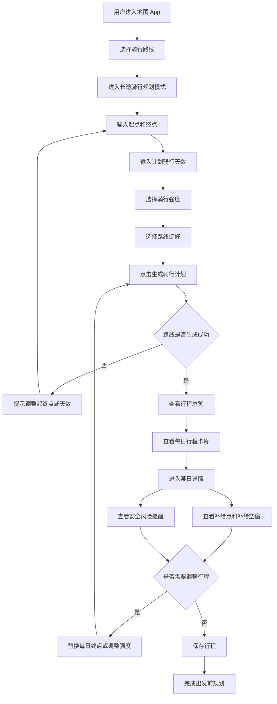
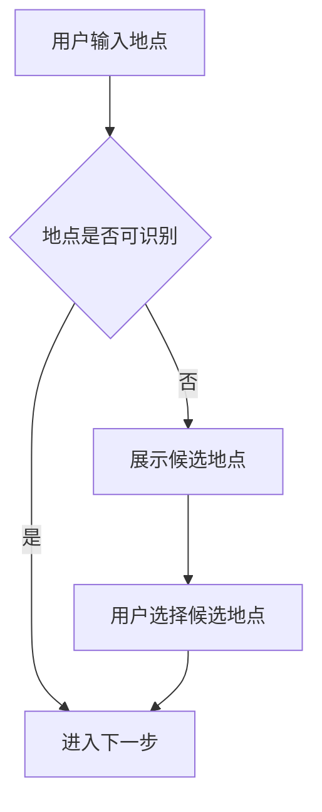
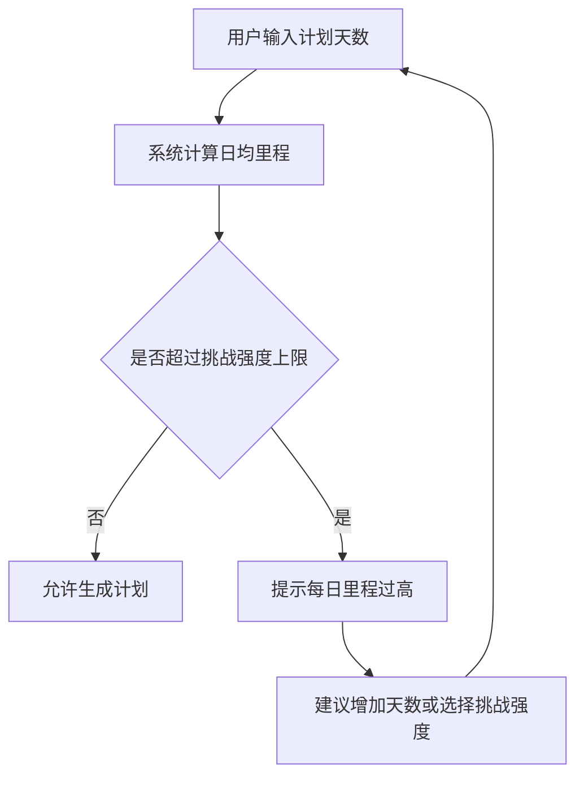
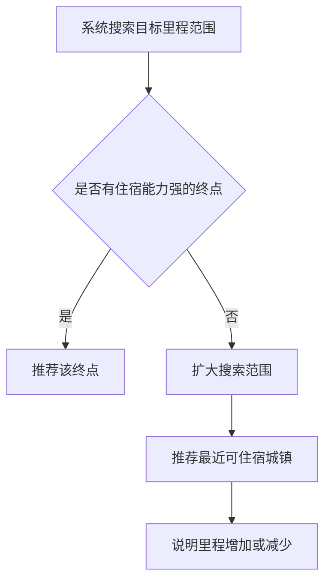

# 骑迹计划用户流程图

## 1. 流程目标

用户流程图用于说明长途骑行者从进入规划入口，到生成分日行程、查看补给与风险、调整计划并保存行程的完整路径。该流程服务于后续低保真原型、Figma 高保真原型和可交互 Demo。

## 2. 核心主流程

## 3. 主流程步骤说明

| 步骤 | 页面/模块 | 用户动作 | 系统反馈 | 产品目的 |
|---|---|---|---|---|
| 1 | 地图首页/路线入口 | 选择骑行路线 | 显示普通骑行路线入口和长途规划入口 | 将长途骑行从普通骑行中区分出来 |
| 2 | 规划页 | 输入起点、终点、天数 | 识别地点并校验天数 | 收集生成计划的最小必要信息 |
| 3 | 规划页 | 选择轻松/标准/挑战强度 | 更新日均里程建议 | 降低新手决策门槛 |
| 4 | 规划页 | 选择住宿、安全、补给、少爬升偏好 | 调整推荐策略 | 让路线结果符合用户真实目标 |
| 5 | 总览页 | 查看总路线和每日卡片 | 展示总里程、总耗时、风险概览 | 快速判断行程是否可执行 |
| 6 | 每日详情页 | 查看某一天路线 | 展示里程、耗时、爬升、推荐终点理由 | 解释系统为什么这样拆分行程 |
| 7 | 补给图层 | 查看餐饮、便利店、住宿、城镇 | 地图上显示补给点和补给密度 | 把 POI 转化为沿途补给决策信息 |
| 8 | 风险提醒 | 查看国道、大车、弱网络等提醒 | 给出具体路段和行动建议 | 帮助用户提前避险 |
| 9 | 行程调整 | 替换终点或调整强度 | 系统重新计算后续行程 | 支持用户保留主动控制权 |
| 10 | 保存行程 | 保存当前计划 | 提示保存成功 | 完成出发前规划闭环 |

## 4. 异常流程

### 4.1 起终点无法识别

处理原则：不要只提示“输入错误”，而是给出候选地点，降低用户修正成本。

### 4.2 计划天数过少

处理原则：系统不直接阻断用户，而是解释为什么不推荐，并给出调整建议。

### 4.3 目标里程范围内无合适住宿点

处理原则：推荐结果必须可解释，尤其当系统偏离用户预期日均里程时。

## 5. 关键决策节点

| 决策节点 | 判断依据 | 用户可见表达 |
|---|---|---|
| 是否能生成路线 | 起终点识别、路网可达性、天数合法性 | 当前路线无法生成，建议调整起终点或天数 |
| 每日终点选哪里 | 住宿、餐饮、补给、里程、安全、次日衔接 | 推荐停靠眉山：住宿和餐饮密度较高 |
| 是否提示补给空窗 | 连续无可靠补给距离是否超过阈值 | 前方 31km 补给较少，建议提前补水 |
| 是否提示安全风险 | 国道/省道占比、隧道、山区、弱网络等 | 该日国道路段较长，建议白天通过 |
| 是否需要重算行程 | 用户修改天数、强度、终点或偏好 | 已根据新偏好重新规划 Day 2 后续行程 |

## 6. 对应页面清单

| 页面 | 流程位置 | 主要任务 |
|---|---|---|
| 路线规划页 | 输入阶段 | 收集起终点、天数、强度、偏好 |
| 行程总览页 | 结果阶段 | 展示总路线和每日计划 |
| 每日行程详情页 | 查看阶段 | 解释某一天路线和终点推荐 |
| 补给图层页 | 决策阶段 | 展示沿途 POI 和补给空窗 |
| 行程调整页 | 修正阶段 | 替换终点、调整强度、重新生成 |
| 保存成功状态 | 完成阶段 | 确认行程已保存 |
