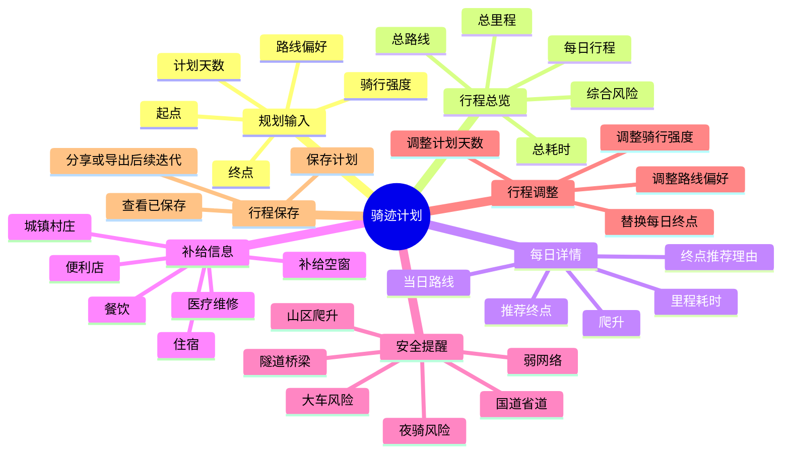
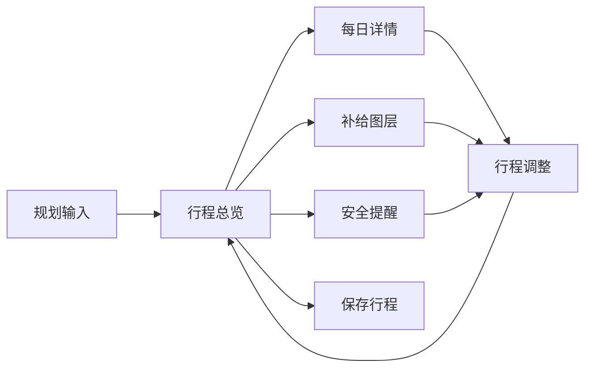

# 骑迹计划信息架构

## 1. 信息架构目标

信息架构用于定义“骑迹计划”中信息如何组织、页面如何分层、用户如何从规划条件进入结果和详情。该架构优先服务 MVP，不纳入社交、社区、训练数据等 P2 能力。

## 2. 一级结构

## 3. 页面层级

| 层级 | 页面/模块 | 说明 |
|---|---|---|
| L1 | 长途骑行规划入口 | 从地图骑行路线中进入，强调“多日规划” |
| L2 | 路线规划页 | 输入起终点、天数、强度、偏好 |
| L2 | 行程总览页 | 承载核心结果，是 Demo 和高保真原型的主页面 |
| L3 | 每日行程详情页 | 查看 Day 1/2/3 的具体路线、补给和风险 |
| L3 | 补给图层页 | 按类型筛选沿途补给点 |
| L3 | 行程调整页 | 替换终点或调整参数后重新生成 |
| L4 | POI 详情弹层 | 点击补给点后展示名称、类型、距离路线、营业信息 |
| L4 | 风险详情弹层 | 点击风险提示后展示路段、原因、建议 |
| L4 | 保存成功状态 | 保存行程后的轻反馈 |

## 4. 主页面布局信息架构

高保真原型和 Demo 建议采用三栏工具型布局。

| 区域 | 信息模块 | 用户任务 |
|---|---|---|
| 左侧规划面板 | 起点、终点、天数、强度、偏好、生成按钮 | 输入和修改规划条件 |
| 中间地图画布 | 路线、分日路段、补给点、补给空窗、城镇标签 | 从空间维度理解行程 |
| 右侧详情面板 | 每日行程卡片、补给风险、安全提醒、保存按钮 | 从列表维度判断计划是否可执行 |

这种结构适合地图产品：左侧是控制，中心是空间结果，右侧是决策解释。

## 5. 信息优先级

### 5.1 P0 信息

| 信息 | 原因 |
|---|---|
| 起点/终点 | 生成路线的基础 |
| 计划天数 | 分日规划的核心输入 |
| 骑行强度 | 决定日均里程和补给阈值 |
| 每日终点 | 解决“每天骑到哪里”的关键问题 |
| 沿途补给点 | 解决“哪里能补给”的关键问题 |
| 补给空窗 | 从点位展示升级为风险判断 |
| 安全提醒 | 支持用户提前避险 |

### 5.2 P1 信息

| 信息 | 原因 |
|---|---|
| 替换终点候选 | 给用户主动调整空间 |
| 离线地图提醒 | 弱网络风险下的可操作建议 |
| 预计爬升 | 影响体力和行程安排 |
| 推荐理由 | 增强系统可信度 |

### 5.3 P2 信息

| 信息 | 暂缓原因 |
|---|---|
| GPX 导出 | 对进阶用户有用，但不是 MVP 必须 |
| 天气深度联动 | 数据复杂，容易扩大范围 |
| 社区反馈 | 需要内容和审核机制 |
| 组队分享 | 偏社交，不是核心规划能力 |

## 6. 导航结构

## 7. 内容字段设计

### 7.1 每日行程卡片

| 字段 | 示例 | 说明 |
|---|---|---|
| Day 编号 | Day 2 | 标识第几天 |
| 起终点 | 眉山 → 夹江 | 当日路线范围 |
| 里程 | 88km | 判断强度 |
| 耗时 | 5.7h | 判断时间安排 |
| 爬升 | 540m | 判断体力消耗 |
| 补给状态 | 补给中 | 判断是否要提前准备 |
| 推荐理由 | 夹江周边补给可衔接 | 解释终点推荐 |

### 7.2 补给点信息

| 字段 | 示例 | 说明 |
|---|---|---|
| 类型 | 便利店 | 餐饮/便利店/住宿/城镇等 |
| 名称 | XX 便利店 | POI 名称 |
| 距路线 | 280m | 判断是否顺路 |
| 营业信息 | 营业中/未知 | 数据可信度提示 |
| 所属日程 | Day 2 | 关联每日行程 |

### 7.3 安全提醒信息

| 字段 | 示例 | 说明 |
|---|---|---|
| 风险类型 | 国道路段 | 便于用户快速识别 |
| 位置 | Day 2 第 47-63km | 具体到路段 |
| 风险原因 | 大车较多 | 必须可解释 |
| 建议动作 | 建议白天通过 | 给出可执行建议 |

## 8. 设计原则

1. 地图优先：空间信息放在中心，避免让用户只看列表。
2. 决策解释：每日终点、补给风险、安全提醒都必须说明原因。
3. 控制和结果分离：左侧输入，中心结果，右侧解释。
4. 风险不恐吓：用“建议提前准备”替代夸张警示。
5. MVP 聚焦：不引入社交、训练、天气等非核心模块。
